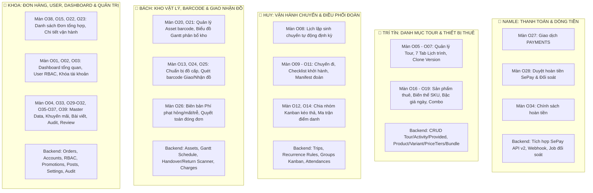

# Kế hoạch Phân công Triển khai Phân hệ Admin — RenTrekk (5 Thành viên)

> **Dự án:** RenTrekk — Hệ thống Đặt Tour Trekking & Cho thuê Thiết bị Dã ngoại  
> **Tài liệu tham chiếu:** [`03-API-CONTRACT.md`](03-API-CONTRACT.md), [`01-CONVENTIONS.md`](docs/01-CONVENTIONS.md), [`Screen_Spec.md`](RenTrekk%20Design%20System/uploads/Screen_Spec.md), [`PRD_RenTrekk.md`](RenTrekk%20Design%20System/uploads/PRD_RenTrekk.md)  
> **Nguyên tắc cốt lõi:** **Vertical Slice (Lát cắt dọc — Full-stack Ownership)**. Mỗi thành viên chịu trách nhiệm trọn gói từ **Database Schema → Backend Service/API → Frontend Page/Component** cho các màn hình mình phụ trách.  
> **Danh sách thành viên:**
> 1. **Namle** (Cố định): Phân hệ Thanh toán & Dòng tiền
> 2. **Trí Tín** (Cố định): Phân hệ Danh mục Tour & Thiết bị Thuê
> 3. **Huy**: Phân hệ Vận hành Chuyến đi, Điều phối Đoàn & **Giao diện Hướng dẫn viên (Guide G01 – G06)**
> 4. **Bách**: Phân hệ Kho vật lý, Barcode Scanner & Giao nhận đồ (Staff kho)
> 5. **Khoa**: Phân hệ Đơn hàng, Quản trị User, Nội dung & Dashboard

---

## 0. Làm rõ: Vai trò của STAFF và GUIDE trong Kế hoạch này

Nhiều bạn thắc mắc kế hoạch này đã bao gồm công việc của **Staff** và **Guide** chưa, câu trả lời là: **ĐÃ BAO GỒM ĐẦY ĐỦ 100%**. Cụ thể:

1. **Về phía STAFF (Nhân viên vận hành, điều phối, thủ kho):**
   - Theo tài liệu `Screen_Spec.md` và `03-API-CONTRACT.md`, toàn bộ khu vực **`O` (Operations: O01 đến O39)** là **khu vực dùng chung giữa Staff và Admin**.
   - Các màn hình điều phối chuyến (`O09 – O15`), quản lý kho thiết bị (`O20 – O21`), giao nhận đồ bằng barcode (`O24 – O25`), lập phí phạt (`O26`) chính là màn hình làm việc hằng ngày của **Staff**.
   - Phân quyền Backend đã quy định: Staff chỉ xem và thao tác trên chuyến mình điều phối (`TRIPS.managed_by_user_id`) hoặc đơn thuê mình xử lý (`RENTAL_ORDERS.handled_by_user_id`), trong khi Admin có quyền tối cao (duyệt hoàn tiền SePay, hủy phí phạt, khóa tài khoản, phân role).
   - Vì vậy, công việc của Staff đã nằm trọn vẹn trong phần việc của cả 5 bạn (đặc biệt là **Huy**, **Bách** và **Khoa**).

2. **Về phía GUIDE (Hướng dẫn viên dẫn tour ngoài thực địa):**
   - Guide có khu vực giao diện riêng được thiết kế tối ưu cho di động/tablet ngoài thực địa gồm **6 màn hình (G01 đến G06)**:
     - `G01`: Chuyến hôm nay / sắp tới (chỉ thấy chuyến mình phụ trách dẫn)
     - `G02`: Chi tiết nhóm (danh sách khách trong nhóm mình dẫn)
     - `G03`: Chi tiết participant (liên hệ khẩn cấp, đồ được cấp của khách)
     - `G04`: Điểm danh thực địa (nút bấm to: Có mặt / Vắng / Muộn trên điện thoại)
     - `G05`: Lịch trình chuyến (timeline hoạt động tour đang dẫn)
     - `G06`: Đồ cấp của nhóm (danh sách thiết bị được phát cho nhóm)
   - **Về API Backend:** Guide sở hữu **phân hệ API riêng biệt (Mục 24 trong Contract: 24.1 – 24.6 `/api/v1/guide/*`)** gồm 6 endpoint độc lập, tinh gọn cho mobile, bảo mật tuyệt đối (không lộ doanh thu hay giá tour) và hỗ trợ offline sync trên thiết bị di động khi leo núi.
   - **Về phân công Frontend:** Toàn bộ 6 màn hình `G01 – G06` này được giao trực tiếp cho **HUY** (kết hợp với phân hệ Chuyến đi & Điểm danh) để Huy làm chủ trọn gói luồng thực địa từ góc nhìn Điều phối viên (O09–O14) đến góc nhìn Hướng dẫn viên (G01–G06).

---

## 1. Sơ đồ Phân chia Bounded Contexts theo Thành viên

---

## 2. Kế hoạch Chi tiết cho từng Thành viên

---

### 👤 1. NAMLE: Chuyên trách Thanh toán, SePay, Hoàn tiền & Đối soát (Finance & Payment Gateway)
> **Trọng tâm:** Kiểm soát dòng tiền ra/vào của toàn bộ nền tảng, tích hợp cổng ngân hàng tự động SePay API v2, xử lý tự động lệnh hoàn tiền và giải quyết đối soát sai lệch tiền nộp.

#### A. Danh sách Màn hình Frontend (UI)
1. **`O27` — Giao dịch tài chính (PAYMENTS):** Bảng kê khai dòng tiền Thu (`Collection`) và Hoàn (`Refund`), lọc theo mục đích (`TourFee`, `RentalFee`, `AdditionalCharge`), trạng thái và thời gian.
2. **`O28` — Hoàn tiền & Đối soát:**
   - Tab *Chờ duyệt*: Duyệt hoàn tiền tự động qua SePay (`PendingApproval` → `Pending`).
   - Tab *Thất bại*: Thử lại hoàn tiền lỗi (tối đa 3 lần) hoặc đánh dấu hoàn thủ công qua Internet Banking (`mark-manual`).
   - Tab *Cần đối soát*: Xử lý đơn chuyển thừa/thiếu tiền (`reconcile-accept` tự động hoàn tiền thừa, `reconcile-refund` hoàn tiền 100% và đóng đơn).
3. **`O34` — Chính sách hoàn tiền:** Bảng mốc thời gian trước khởi hành vs % tiền hoàn, biểu đồ bậc thang trực quan, khóa chính sách đã dùng và nhân bản version mới.
4. **Hỗ trợ tích hợp:** Modal VietQR nạp tiền thu phí bổ sung ở màn `O26` (hỗ trợ Bách) và API thu tiền thủ công ngoài hệ thống ở màn `O15` (hỗ trợ Khoa).

#### B. Danh sách API Backend phụ trách (Mục 17, 20 trong `03-API-CONTRACT.md`)
- `GET /api/v1/admin/payments` (17.1)
- `GET /api/v1/admin/refunds` (17.2)
- `POST /api/v1/admin/refunds/{paymentId}/approve` (17.3)
- `POST /api/v1/admin/refunds/{paymentId}/retry` (17.4)
- `POST /api/v1/admin/refunds/{paymentId}/mark-manual` (17.5)
- `POST /api/v1/admin/orders/{orderId}/reconcile-accept` (17.6)
- `POST /api/v1/admin/orders/{orderId}/reconcile-refund` (17.7)
- `GET/POST/PUT /api/v1/admin/refund-policies` (20.1 – 20.4)
- `PUT /api/v1/admin/refund-policies/{policyId}/rules` (20.5)
- `POST /api/v1/admin/refund-policies/{policyId}/clone-version` (20.6)
- Webhook xử lý giao dịch ngân hàng: `POST /api/v1/payments/webhooks/sepay`

#### C. Database Tables sở hữu
- `payments`, `refund_policies`, `refund_policy_rules`.

#### D. Nhiệm vụ kỹ thuật trọng yếu
- Tích hợp SePay API v2: Gọi lệnh hoàn tiền đơn hàng `POST /v2/bank-accounts/{ba_xid}/orders/{order_xid}/refund` với header `X-Idempotency-Key`.
- Cấu hình Rate limiting (10 request/60s đối với API duyệt hoàn tiền).
- Viết Background Job kiểm tra trạng thái lệnh hoàn và job đối soát các đơn `NeedsReconciliation`.

---

### 👤 2. TRÍ TÍN: Chuyên trách Danh mục Tour & Thiết bị Thuê (Catalog & Inventory Setup)
> **Trọng tâm:** "Kiến trúc sư sản phẩm" — xây dựng dữ liệu cốt lõi cho việc bán hàng: cấu trúc Tour trekking nhiều ngày, thư viện media, định mức đồ cấp, bảng giá thuê linh hoạt theo số ngày và các gói combo.

#### A. Danh sách Màn hình Frontend (UI)
1. **`O05` — Danh sách Tour:** Hiển thị danh sách tour, bộ lọc danh mục/địa điểm/trạng thái, hiển thị phiên bản mới nhất.
2. **`O06` — Trình chỉnh sửa Tour (7 Tab độc lập):**
   - Tab 1: Thông tin chung (tên, ngày, đêm, giá cơ sở, trạng thái khóa lịch trình `itinerary_locked_at`).
   - Tab 2: Thư viện ảnh (upload ảnh, kéo thả sắp xếp `display_order`, đặt ảnh chính `is_primary`).
   - Tab 3: Lịch trình chi tiết (timeline kéo thả các hoạt động theo từng Ngày 1..N kèm giờ bắt đầu, thời lượng).
   - Tab 4: Đồ tự mang (checklist đồ khách tự chuẩn bị).
   - Tab 5: Đồ được cấp (chọn variant thiết bị, số lượng, cơ sở tính theo Người/Nhóm/Chuyến).
   - Tab 6: Bài viết hướng dẫn gắn kèm tour.
   - Tab 7: Lịch sử phiên bản.
3. **`O07` — Lịch sử phiên bản Tour:** Drawer xem cây phiên bản cùng `tour_family_id`, diff so sánh sai khác 2 phiên bản và nút nhân bản (`clone`).
4. **`O16` — Danh sách Sản phẩm thuê:** Xem danh mục sản phẩm cha, số variant con, tổng tồn kho và số lượng sẵn sàng.
5. **`O17` — Sản phẩm & Biến thể SKU:** Quản lý master-detail sản phẩm cha và các biến thể con (SKU, size, màu, ảnh) + Bảng bậc giá thuê theo khoảng ngày không chồng lấn (`RENTAL_PRICE_TIERS`).
6. **`O18` — Bảng giá thuê tổng hợp:** Bảng tra cứu giá toàn kho gom chung biến thể lẻ và combo.
7. **`O19` — Quản lý Combo thiết bị:** Tạo gói combo, chọn danh sách thiết bị thành phần và thiết lập bảng giá thuê combo.

#### B. Danh sách API Backend phụ trách (Mục 6, 13 trong `03-API-CONTRACT.md`)
- `GET/POST/PUT /api/v1/admin/tours` (6.1 – 6.4)
- `POST /api/v1/admin/tours/{id}/publish`, `/archive` (6.5 – 6.6)
- `GET/POST/PUT/DELETE /api/v1/admin/tours/{id}/images` (6.7 – 6.10)
- `GET/POST/PUT/DELETE /api/v1/admin/tours/{id}/activities` (6.11 – 6.15)
- `GET/PUT /api/v1/admin/tours/{id}/preparation-items` (6.16 – 6.17)
- `GET/POST/PUT/DELETE /api/v1/admin/tours/{id}/provided-items` (6.18 – 6.21)
- `GET/PUT /api/v1/admin/tours/{id}/posts` (6.22 – 6.23)
- `GET/POST/GET /api/v1/admin/tours/{id}/versions` (6.24 – 6.26)
- `GET/POST/PUT/DELETE /api/v1/admin/products` (13.1 – 13.5)
- `POST/PUT/DELETE /api/v1/admin/products/{id}/variants` (13.6 – 13.10)
- `GET/PUT /api/v1/admin/variants/{id}/price-tiers` (13.11 – 13.12)
- `GET /api/v1/admin/pricing` (13.13)
- `GET/POST/PUT/DELETE /api/v1/admin/bundles` (13.14 – 13.21)

#### C. Database Tables sở hữu
- `tours`, `tour_images`, `tour_activities`, `tour_preparation_items`, `tour_provided_items`, `tour_posts`.
- `products`, `product_variants`, `product_variant_images`, `rental_price_tiers`, `product_bundles`, `product_bundle_items`.

#### D. Nhiệm vụ kỹ thuật trọng yếu
- Xây dựng logic khóa lịch trình (`itinerary_locked_at`) khi tour đã có booking.
- Viết thuật toán nhân bản phiên bản tour (`clone deep copy`) sang version mới ở trạng thái `Draft`.
- Validate dải bậc ngày thuê (`minDays`, `maxDays`) đảm bảo không bị chồng lấn khoảng ngày.

---

### 👤 3. HUY: Chuyên trách Vận hành Chuyến đi, Điều phối Đoàn & Khu vực Guide (Trip Operations & Guide)
> **Trọng tâm:** Chuyển tour trên giấy thành chuyến đi thực tế, điều phối sức chứa chỗ ngồi, chia nhóm khách dạng Kanban kéo thả, kiểm soát điểm danh và xây dựng toàn bộ **giao diện dành riêng cho Hướng dẫn viên (Guide G01 – G06)** ngoài thực địa.

#### A. Danh sách Màn hình Frontend (UI)
* **Khu vực Vận hành Chuyến (Web Admin/Staff):**
  1. **`O08` — Lịch lặp sinh chuyến:** Cấu hình tần suất sinh chuyến định kỳ (Hằng tuần/tháng), xem trước lịch giả lập tránh trùng ngày (`preview`) và kích hoạt sinh hàng loạt (`generate`).
  2. **`O09` — Danh sách / Lịch chuyến đi:** Xem danh sách chuyến ở 2 chế độ: Bảng dữ liệu hoặc Lịch tháng/tuần tô màu theo trạng thái.
  3. **`O10` — Chi tiết chuyến & Trạng thái:** Mở bán, đóng bán, bắt đầu chuyến, hoàn thành chuyến, hủy chuyến khẩn cấp; widget **Checklist sẵn sàng khởi hành** 5 điều kiện (FR-D07).
  4. **`O11` — Booking & Participants:** Bảng danh sách đơn đặt chỗ, mở rộng xem danh sách từng khách, nguyện vọng đi chung nhóm, xuất file **Manifest hành khách** (CSV/PDF).
  5. **`O12` — Chia nhóm Chuyến (Kanban Board):** Giao diện kéo thả thẻ khách hàng từ cột "Chưa xếp nhóm" vào các cột nhóm, gán Hướng dẫn viên phụ trách, thuật toán tự động chia nhóm (`auto-group`), modal duyệt tách booking đi chung (`is_split`).
  6. **`O14` — Điểm danh Hoạt động (Ma trận 2 chiều):** Lưới điểm danh (Hàng = Khách, Cột = Hoạt động tour). Ô điểm danh chọn Có mặt/Vắng/Muộn; nếu sửa ô đã có bắt buộc nhập lý do và lưu audit log.

* **Khu vực Hướng dẫn viên Thực địa (Guide Web/Mobile G01 – G06):**
  7. **`G01` — Chuyến hôm nay / sắp tới:** Card lớn hiển thị tour, ngày đi, nhóm phụ trách, sĩ số và điểm tập kết bản đồ.
  8. **`G02` — Chi tiết nhóm:** Danh sách khách trong nhóm, số điện thoại liên hệ, nút gọi nhanh, badge trạng thái điểm danh.
  9. **`G03` — Chi tiết participant:** Thông tin người liên hệ khẩn cấp, thiết bị được cấp, tiền sử điểm danh của khách.
  10. **`G04` — Điểm danh thực địa:** 3 nút bấm lớn (Có mặt · Vắng · Muộn), nút "Tất cả có mặt", thanh tiến độ điểm danh, hàng đợi gửi lại khi mất mạng.
  11. **`G05` — Lịch trình chuyến:** Timeline các hoạt động theo ngày, đánh dấu hoạt động đang diễn ra.
  12. **`G06` — Đồ cấp của nhóm:** Danh sách thiết bị và mã asset giao cho nhóm kiểm tra trước khi lên đường.

#### B. Danh sách API Backend phụ trách (Mục 7, 8, 9, 11, 24 trong `03-API-CONTRACT.md`)
* **API Điều hành Tour & Chuyến (Admin/Staff):**
  - `GET/POST/PUT/DELETE /api/v1/admin/tours/{id}/recurrence-rules` (7.1 – 7.4)
  - `POST /api/v1/admin/recurrence-rules/{id}/preview`, `/generate` (7.5 – 7.6)
  - `GET/POST/PUT /api/v1/admin/trips` (8.1 – 8.4)
  - `GET /api/v1/admin/trips/{id}/readiness-checklist` (8.5)
  - `POST /api/v1/admin/trips/{id}/open-booking`, `/close-booking`, `/start`, `/complete`, `/cancel` (8.6 – 8.10)
  - `GET /api/v1/admin/trips/{id}/bookings`, `/manifest` (8.11 – 8.12)
  - `GET /api/v1/admin/trips/{id}/groups-board` (9.1)
  - `POST/PUT/DELETE /api/v1/admin/trips/{id}/groups` (9.2 – 9.4)
  - `PATCH /api/v1/admin/trips/{id}/participants/assign-group` (9.5)
  - `POST /api/v1/admin/trips/{id}/auto-group`, `/split-approve` (9.6 – 9.7)
  - `GET/PUT/GET /api/v1/admin/trips/{id}/attendances` (11.1 – 11.3)
* **API Khu vực Hướng dẫn viên Thực địa (Guide G01 – G06):**
  - `GET /api/v1/guide/trips` (24.1 — Màn G01 xem chuyến hôm nay / sắp tới / đã xong)
  - `GET /api/v1/guide/trips/{tripId}/group` (24.2 — Màn G02 xem chi tiết nhóm & danh sách khách)
  - `GET /api/v1/guide/participants/{participantId}` (24.3 — Màn G03 xem hồ sơ cứu hộ khẩn cấp & đồ cấp của khách)
  - `POST /api/v1/guide/trips/{tripId}/attendances/batch` (24.4 — Màn G04 điểm danh nhanh thực địa, offline sync)
  - `GET /api/v1/guide/trips/{tripId}/itinerary` (24.5 — Màn G05 timeline hoạt động & tiến độ điểm danh)
  - `GET /api/v1/guide/trips/{tripId}/provided-items` (24.6 — Màn G06 kiểm tra đồ cấp đoàn trước khi leo)

#### C. Database Tables sở hữu
- `tour_recurrence_rules`, `trips`, `trip_groups`, `booking_participants`, `activity_attendances`.

#### D. Nhiệm vụ kỹ thuật trọng yếu
- Dựng giao diện Kanban kéo thả mượt mà cho màn `O12` (sử dụng thư viện `dnd-kit` hoặc `react-beautiful-dnd`).
- Viết thuật toán chia nhóm tự động ưu tiên giữ các khách cùng mã đơn đi chung nhóm.
- Dựng bảng ma trận điểm danh 2 chiều responsive, hover xem lịch sử ai đã điểm danh vào lúc nào.

---

### 👤 4. BÁCH: Chuyên trách Kho vật lý, Barcode Scanner & Giao nhận đồ (Warehouse & Fulfillment)
> **Trọng tâm:** Quản lý kho hàng hiện vật, gắn mã vạch QR cho từng thiết bị, kiểm soát trực quan bằng biểu đồ Gantt, tối ưu quy trình quét barcode giao nhận đồ và xử lý bồi thường thiệt hại.

#### A. Danh sách Màn hình Frontend (UI)
1. **`O20` — Thiết bị (Asset) vật lý:** Danh sách từng món đồ có in mã vạch QR, thêm hàng loạt theo tiền tố, cập nhật tình trạng kỹ thuật (Sẵn sàng, Bảo trì, Hỏng, Mất, Thanh lý).
2. **`O21` — Biểu đồ Gantt phân bổ thiết bị:** Trục Y là danh sách Asset, trục X là ngày; thanh Gantt đổi màu theo nguồn sử dụng (Đơn thuê, Đồ cấp chuyến, Quà khuyến mãi); hàng tổng cảnh báo đỏ khi quá tải kho.
3. **`O13` — Chuẩn bị đồ cấp cho chuyến:** Tính toán số lượng cần cấp theo số khách/nhóm thực tế, tra cứu thiết bị trống kho theo khung ngày chuyến đi, gán asset cụ thể.
4. **`O24` — Giao thiết bị (Handover Checklist):** Màn hình quét mã barcode kiểm tra từng món đồ trước khi giao cho khách thuê hoặc giao cho hướng dẫn viên.
5. **`O25` — Nhận lại thiết bị (Return Checklist):** Quét barcode nhận đồ, đánh giá tình trạng vật lý (`Normal`, `Damaged`, `Lost`, trả trễ).
6. **`O26` — Phí phát sinh & Quyết toán đơn thuê:** Lập biên bản phí phạt hỏng/mất/trễ (Draft), chốt phí (Assessed), Admin duyệt hủy phí (Void), nghiệm thu đóng toàn bộ đơn thuê (`Completed`).

#### B. Danh sách API Backend phụ trách (Mục 10, 14, 15.4-15.10, 16 trong `03-API-CONTRACT.md`)
- `GET/POST/GET/PATCH/GET /api/v1/admin/assets` (14.1 – 14.5)
- `GET /api/v1/admin/assets/schedule-gantt` (14.6)
- `GET /api/v1/admin/trips/{id}/provided-items` (10.1)
- `GET/POST/DELETE /api/v1/admin/trips/{id}/provided-items/assignments` (10.2 – 10.4)
- `POST /api/v1/admin/trips/{id}/provided-items/issue`, `/return` (10.5 – 10.6)
- `GET/POST/POST /api/v1/admin/rental-orders/{code}/handover` (15.4 – 15.6)
- `GET/POST/POST/POST /api/v1/admin/rental-orders/{code}/return` (15.7 – 15.10)
- `GET/POST/POST/POST /api/v1/admin/rental-orders/{code}/charges` (16.1 – 16.5)
- `POST /api/v1/admin/rental-orders/{code}/complete` (16.6)

#### C. Database Tables sở hữu
- `equipment_assets`, `asset_assignments`, `trip_provided_items`, `rental_charges`.

#### D. Nhiệm vụ kỹ thuật trọng yếu
- Dựng UI biểu đồ Gantt Chart trực quan (`O21`) có khả năng cuộn ngang theo tháng, hiển thị thanh tiến độ theo thời gian thực.
- Xử lý sự kiện input quét mã vạch barcode (tự động focus, phát âm thanh báo đúng/sai khi thủ kho quét hàng loạt món đồ ở `O24, O25`).
- Thuật toán kiểm tra xung đột tồn kho: tìm asset không bị giữ chỗ (`Reserved` hoặc `Issued`) trong khoảng `[from, to]`.

---

### 👤 5. KHOA: Chuyên trách Đơn hàng, Quản trị Người dùng, Nội dung & Dashboard (Orders, Users & Governance)
> **Trọng tâm:** Người quản trị hệ thống — theo dõi danh sách đơn hàng tổng hợp, quản lý danh tính tài khoản nhân viên/khách hàng, xuất bản bài viết cẩm nang và hiển thị Dashboard tổng thể.

#### A. Danh sách Màn hình Frontend (UI)
1. **`O38` — Danh sách đơn hàng tổng hợp:** Màn hình tập trung lọc cả Đơn Tour & Đơn Thuê theo hạn giữ chỗ, hạn đối soát.
2. **`O15` — Chi tiết đơn tour vận hành:** Xem thông tin đặt chỗ, sửa thông tin người tham gia thay khách có audit, ghi nhận thanh toán thủ công.
3. **`O22`, `O23` — Danh sách & Chi tiết đơn thuê vận hành:** Quản lý danh sách đơn thuê, nút nhận phụ trách xử lý (`claim`), xem chi tiết các dòng thuê và combo.
4. **`O01` — Dashboard vận hành:** Màn hình trang chủ của Admin/Staff, nạp 3 widget độc lập: đếm số badge nhanh (`/stats`), danh sách cảnh báo khẩn (`/alerts`), chỉ số KPI tuần/tháng (`/kpis`).
5. **`O02`, `O03` — Quản trị Người dùng:** Bảng danh sách tài khoản, nút tạo Staff/Guide, Tab đổi vai trò Role, Tab khóa tài khoản kèm lý do, Tab xem/thu hồi phiên đăng nhập `refresh_tokens`, Tab tra cứu audit log user.
6. **`O04`, `O33` — Master Data:** Danh mục, Địa điểm (tọa độ GPS hiển thị bản đồ), Tags bài viết, Kỹ năng mềm.
7. **`O29`, `O30`, `O31` — Quản lý Khuyến mãi:** Danh sách khuyến mãi, cấu hình bậc giảm giá (%/tiền mặt/tặng mượn đồ kho), lịch sử các đơn hàng đã áp dụng mã.
8. **`O32` — Bài viết & Cẩm nang:** Trình soạn thảo rich-text, gắn tag/kỹ năng, xuất bản/lưu trữ, thống kê số khách đã đọc bài trước khi đi tour.
9. **`O35`, `O36` — Cấu hình hệ thống & Audit Logs:** Quản lý tham số hệ thống toàn cục, tra cứu nhật ký kiểm toán hệ thống.
10. **`O37` — Báo cáo vận hành:** Báo cáo doanh thu ròng, tỷ lệ lấp chỗ, hiệu suất khai thác thiết bị kho.
11. **`O39` — Kiểm duyệt Đánh giá (Review):** Lọc đánh giá theo số sao, ẩn đánh giá vi phạm kèm lý do (chặn sửa nội dung).

#### B. Danh sách API Backend phụ trách (Mục 1, 2, 3, 4, 5, 12, 15.1-15.3, 18, 19, 21, 22, 23 trong `03-API-CONTRACT.md`)
- `POST /api/v1/auth/register`, `/login`, `/refresh-token`, `/logout` (1.1 – 1.4)
- `GET/PUT /api/v1/users/me` (2.1 – 2.2)
- `GET /api/v1/admin/dashboard/stats`, `/alerts`, `/kpis` (3.1 – 3.3)
- `GET/POST/GET/PUT/PATCH/POST /api/v1/admin/users` (4.1 – 4.11)
- `GET/POST/PUT/DELETE /api/v1/admin/categories`, `/locations`, `/tags`, `/soft-skills` (5.1 – 5.16)
- `GET/GET/PATCH/POST/POST /api/v1/admin/orders` (12.1 – 12.5)
- `GET/POST/GET /api/v1/admin/rental-orders` (15.1 – 15.3)
- `GET/POST/GET/PUT/PATCH/PUT/GET /api/v1/admin/promotions` (18.1 – 18.7)
- `GET/POST/GET/PUT/DELETE/POST/GET /api/v1/admin/posts` (19.1 – 19.8)
- `GET/PUT/GET /api/v1/admin/settings`, `/audit-logs` (21.1 – 21.3)
- `GET /api/v1/admin/reports/revenue`, `/trip-occupancy`, `/asset-utilization`, `/refunds-and-charges` (22.1 – 22.4)
- `GET/POST/POST /api/v1/admin/reviews` (23.1 – 23.3)

#### C. Database Tables sở hữu
- `accounts`, `profiles`, `roles`, `refresh_tokens`, `categories`, `locations`, `tags`, `soft_skills`.
- `orders`, `rental_orders`, `rental_order_items`, `rental_bundle_item_snapshots`.
- `promotions`, `promotion_tiers`, `applied_promotions`, `posts`, `system_configurations`, `audit_logs`, `reviews`.

#### D. Nhiệm vụ kỹ thuật trọng yếu
- Thiết lập hệ thống xác thực JWT Bearer, phân quyền Role (Admin, Staff, Guide, Customer).
- Xây dựng layout chung cho trang Admin (Sidebar, Header chuông thông báo, Global Search).
- Tạo các bảng danh sách dùng chung (Re-usable DataTable component có sort, filter, phân trang, export CSV).

---

## 3. Bảng Tổng hợp Khối lượng 5 Thành viên

| Thành viên | Trách nhiệm chính | Màn hình Frontend | Số lượng API | Điểm cốt lõi kỹ thuật |
|:---:|---|:---:|:---:|---|
| **Namle** | **Thanh toán & Dòng tiền** | `O27, O28, O34` | ~15 API | Tích hợp cổng SePay API v2, Webhook, Job đối soát, Duyệt hoàn tiền tự động, Rate limit. |
| **Trí Tín** | **Danh mục Tour & Thuê đồ** | `O05, O06, O07, O16, O17, O18, O19` | ~47 API | 7 tab Tour Editor, Bậc giá thuê theo ngày, Combo thiết bị, Nhân bản phiên bản tour deep clone. |
| **Huy** | **Vận hành Chuyến, Đoàn & Guide thực địa** | `O08, O09, O10, O11, O12, O14` + `G01 – G06` (Khu vực Guide) | ~28 API (Guide dùng chung) | Bảng Kanban kéo thả chia nhóm, Ma trận điểm danh 2 chiều, Lịch lặp sinh chuyến, Giao diện Guide mobile thực địa. |
| **Bách** | **Kho, Barcode & Giao nhận** | `O20, O21, O13, O24, O25, O26` | ~28 API | Biểu đồ Gantt chiếm dụng kho, Quét barcode QR tức thời giao/nhận đồ, Biên bản phạt hư hại/mất đồ. |
| **Khoa** | **Đơn hàng, User & Hệ thống** | `O38, O15, O22, O23, O01, O02, O03, O04, O33, O29-O32, O35-O37, O39` | ~46 API | Quản lý đơn hàng chung, User RBAC, Khóa tài khoản, Dashboard KPI, Khuyến mãi, Audit logs, Review. |

---

## 4. Lộ trình Triển khai theo 4 Tuần (Sprint Roadmap)

| Giai đoạn | Tuần 1: Khung & Master Data | Tuần 2: Core Entities & Luồng chính | Tuần 3: Tác vụ phức tạp & State Machine | Tuần 4: Báo cáo, Tích hợp E2E & Nghiệm thu |
|---|---|---|---|---|
| **Namle (Finance)** | Dựng DB `payments`, `refund_policies`. Viết API CRUD chính sách hoàn tiền (`O34`). | Viết API Giao dịch `O27`. Tích hợp Webhook SePay nhận biến động số dư. | Viết API Duyệt hoàn tiền SePay + Đối soát `O28`. Tạo modal thanh toán VietQR cho phí phạt `O26`. | Kiểm thử tự động hoàn tiền SePay, test đơn thiếu/thừa tiền, tối ưu Rate limiting. |
| **Trí Tín (Catalog)** | Dựng DB `products`, `variants`, `tours`. Viết API Danh mục tour `O05` & Sản phẩm `O16`. | Viết API Tour Editor 7 tab `O06` & Biến thể, Bảng giá bậc ngày `O17, O18`. | Viết API Combo `O19`, Nhân bản phiên bản tour deep clone `O07`. | Tối ưu upload ảnh thư viện, kiểm tra toàn bộ ràng buộc không chồng lấn bậc giá ngày. |
| **Huy (Trips & Guide)** | Dựng DB `trips`, `trip_groups`. Viết API Lịch chuyến `O09` & Tạo chuyến thủ công. | Viết API Lịch lặp sinh chuyến `O08`, Checklist sẵn sàng `O10`, Manifest `O11`. | Dựng BE/FE Bảng chia nhóm Kanban `O12` kéo thả & Ma trận điểm danh 2 chiều `O14`. | Dựng BE/FE khu vực Guide `G01 – G06` (API 24.1 – 24.6: Điểm danh thực địa, liên hệ khẩn cấp, offline sync), kiểm thử E2E luồng điều phối đoàn. |
| **Bách (Warehouse)** | Dựng DB `equipment_assets`, `asset_assignments`. Viết API Quản lý Asset barcode `O20`. | Viết API Chuẩn bị đồ cấp `O13`. Dựng API tìm kiếm thiết bị trống kho theo ngày. | Dựng BE/FE Biểu đồ Gantt `O21`, API quét barcode giao nhận `O24, O25` & Phí phạt `O26`. | Kiểm thử hiện trường với máy quét mã vạch barcode, kiểm tra đóng đơn thuê hoàn tất. |
| **Khoa (Core Admin)** | Dựng DB `accounts`, `orders`. Cấu hình JWT, RBAC, Layout Admin, Master Data `O04, O33`. | Viết API User RBAC `O02, O03`, Đơn hàng tổng hợp `O38, O15, O22, O23`. | Viết API Khuyến mãi `O29-O31`, Bài viết `O32`, Dashboard widget `O01`. | Viết API Báo cáo `O37`, Audit log `O36`, Review `O39`. Kiểm thử toàn diện phân quyền role. |

---

## 5. Quy tắc Phối hợp Nhóm (Zero Git Conflict Guidelines)

1. **Tuân thủ Tuyệt đối Hợp đồng API:**
   - Mọi cấu trúc DTO gửi/nhận bắt buộc đối chiếu 1-1 với file [`03-API-CONTRACT.md`](03-API-CONTRACT.md).
   - Nếu trong quá trình code thực tế phát sinh thêm trường dữ liệu, người sửa phải thông báo trên nhóm và cập nhật file Contract trước khi sửa code.

2. **Quy ước Đặt tên Branch Git theo Tên:**
   - `feature/namle-payments-and-refunds` (Namle)
   - `feature/tritin-tour-and-product-catalog` (Trí Tín)
   - `feature/huy-trip-operations-and-kanban` (Huy)
   - `feature/bach-warehouse-gantt-barcode` (Bách)
   - `feature/khoa-orders-users-and-governance` (Khoa)

3. **Phân chia Thư mục Mã nguồn Độc lập:**
   - **Frontend (`src/`):**
     - Namle: `src/pages/ops/finance/` (Giao dịch, Hoàn tiền, Chính sách)
     - Trí Tín: `src/pages/ops/catalog/` (Tour, Lịch trình, Sản phẩm, Bảng giá, Combo)
     - Huy: `src/pages/ops/trips/` (Chuyến đi, Lịch lặp, Kanban, Điểm danh)
     - Bách: `src/pages/ops/warehouse/` (Asset, Gantt, Bàn giao, Thu hồi, Phí phạt)
     - Khoa: `src/pages/ops/system/` và `src/pages/ops/orders/` (Dashboard, Users, Đơn hàng, Khuyến mãi, Bài viết, Setting)
   - **Backend (`RenTrek.API/` & `RenTrek.BLL/`):**
     - Mỗi thành viên tự tạo thư mục riêng trong Controllers, Services, DTOs, Validators theo đúng tên miền nghiệp vụ của mình. Không chạm vào Controller của nhau.
