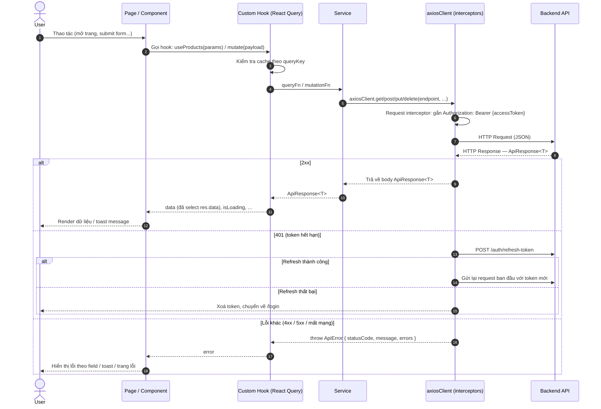

# 01 — Coding Conventions & Workflow (Frontend)

> Tài liệu quy định chung cho team Frontend **renTrek** (ReactJS).
> Mọi thành viên **bắt buộc** tuân theo. Khi cần thay đổi rule, tạo PR sửa file này và thông báo cho cả team.
>
> Contract với Backend: xem `BE/docs/01-CONVENTIONS.md` (mục 3, 4) và `BE/docs/03-API-CONTRACT.md`.
> Nếu tài liệu này mâu thuẫn với API Contract của BE → **API Contract của BE là chuẩn**, báo lại để sửa file này.

**Tech stack:**

| Hạng mục | Thư viện |
|---|---|
| Build tool | Vite |
| UI | React 19 (function component + hooks), JavaScript (`.jsx`) |
| Routing | React Router v7 (`react-router-dom`, data router `createBrowserRouter`) |
| HTTP client | Axios |
| Server state (gọi API, cache) | TanStack Query (React Query) v5 |
| Form | React Hook Form |
| Thông báo | react-toastify |
| Ngày giờ | dayjs |
| Lint / format | ESLint 10 (flat config `eslint.config.js`) + Prettier |

**Chạy dự án:** xem [`README.md`](../README.md).

## Mục lục

1. [Naming Convention](#1-naming-convention)
2. [Cấu trúc thư mục](#2-cấu-trúc-thư-mục)
3. [Flow xử lý Request → Response](#3-flow-xử-lý-request--response)
4. [Cấu trúc Request](#4-cấu-trúc-request)
5. [Cấu trúc Response & xử lý lỗi](#5-cấu-trúc-response--xử-lý-lỗi)
6. [Git: Branch, Commit, Push](#6-git-branch-commit-push)
7. [Checklist trước khi tạo PR](#7-checklist-trước-khi-tạo-pr)

---

## 1. Naming Convention

### 1.1. File & thư mục

| Loại | Quy tắc | Ví dụ |
|---|---|---|
| Component | `PascalCase.jsx`, tên file = tên component | `ProductCard.jsx`, `ConfirmModal.jsx` |
| Page (gắn với route) | `{Tên}Page.jsx` | `ProductListPage.jsx`, `ProductDetailPage.jsx` |
| Layout | `{Tên}Layout.jsx` | `MainLayout.jsx`, `AdminLayout.jsx` |
| Custom hook | `use{Tên}.js` (camelCase) | `useProducts.js`, `useDebounce.js` |
| Service gọi API | `{entity}Service.js` | `productService.js`, `authService.js` |
| Query keys | `{entity}Keys.js` | `productKeys.js` |
| Context | `{Tên}Context.js` (createContext) + `{Tên}Provider.jsx` + hook `use{Tên}.js` trong `hooks/` | `AuthContext.js`, `AuthProvider.jsx`, `useAuth.js` |
| Utils / helpers | `camelCase.js` | `formatCurrency.js`, `cleanParams.js` |
| Constants | `camelCase.js` | `routes.js`, `enums.js` |
| CSS Module | `{Component}.module.css` | `ProductCard.module.css` |
| Thư mục feature | `kebab-case`, **số nhiều** | `features/products`, `features/rental-orders` |
| Thư mục còn lại | `camelCase` | `components`, `hooks`, `utils` |
| Ảnh / icon | `kebab-case` | `logo-dark.svg`, `empty-cart.png` |

### 1.2. Trong code

| Thành phần | Quy tắc | Ví dụ |
|---|---|---|
| Component | `PascalCase`, danh từ | `ProductCard`, `BookingTable` |
| Biến, hàm, tham số | `camelCase` | `productId`, `fetchProducts` |
| Hằng số cố định | `UPPER_SNAKE_CASE` | `DEFAULT_PAGE_SIZE`, `API_ENDPOINTS` |
| Boolean | Tiền tố `is` / `has` / `can` / `should` | `isLoading`, `hasError`, `canCancel` |
| Hàm xử lý event (trong component) | `handle{Sự kiện}` | `handleSubmit`, `handleDeleteClick` |
| Prop nhận callback | `on{Sự kiện}` | `onSubmit`, `onDelete`, `onPageChange` |
| Custom hook | Tiền tố `use` | `useAuth`, `useCreateProduct` |
| Hook gọi API — đọc | `use{Entity}` / `use{Entities}` | `useProduct(id)`, `useProducts(params)` |
| Hook gọi API — ghi | `use{Action}{Entity}` | `useCreateProduct`, `useUpdateProduct`, `useDeleteProduct` |
| Method trong service | `getAll`, `getById`, `create`, `update`, `remove` + hành động riêng | `bookingService.cancel(id)` |
| Enum (đồng bộ với BE) | Object `UPPER_SNAKE_CASE`, value = string BE trả về | `BOOKING_STATUS.PENDING = 'Pending'` |
| Biến môi trường | Tiền tố `VITE_` + `UPPER_SNAKE_CASE` | `VITE_API_BASE_URL` |
| CSS class (CSS Module) | `camelCase` | `styles.cardTitle` |

**Quy tắc chung:**

- Mỗi file chỉ chứa **1 component** chính. Component dùng `export default`; hook, service, util dùng **named export**.
- Chỉ dùng **function component**, không dùng class component.
- Không viết tắt khó hiểu (`prd`, `usr`, `btn1`, `data2`...). Chấp nhận: `id`, `url`, `api`, `params`, `props`.
- Không đặt tên chung chung: `data`, `list`, `item`, `temp` → dùng `products`, `selectedBooking`...
- Import qua alias `@/` (trỏ tới `src/`), không dùng đường dẫn tương đối quá 2 cấp (`../../../`).
- Field dữ liệu từ API **giữ nguyên camelCase** như BE trả về, **không** đổi tên ở FE.

### 1.3. Route (URL trên trình duyệt)

- Chữ thường, `kebab-case`, resource **số nhiều**: `/products`, `/rental-orders`.
- Path param `camelCase`: `/products/:productId`.
- Trang admin có prefix `/admin`: `/admin/products`.
- Không hard-code path trong component — khai báo trong `src/constants/routes.js`:

```js
export const ROUTES = {
  HOME: '/',
  LOGIN: '/login',
  PRODUCTS: '/products',
  PRODUCT_DETAIL: (productId = ':productId') => `/products/${productId}`,
  ADMIN_PRODUCTS: '/admin/products',
  FORBIDDEN: '/403',
};
```

### 1.4. Enum đồng bộ với BE

BE serialize enum dạng **string** → FE khai báo đúng string đó:

```js
// src/constants/enums.js
export const BOOKING_STATUS = Object.freeze({
  PENDING: 'Pending',
  CONFIRMED: 'Confirmed',
  CANCELLED: 'Cancelled',
});

export const BOOKING_STATUS_LABEL = {
  [BOOKING_STATUS.PENDING]: 'Chờ xác nhận',
  [BOOKING_STATUS.CONFIRMED]: 'Đã xác nhận',
  [BOOKING_STATUS.CANCELLED]: 'Đã huỷ',
};
```

❌ Không so sánh chuỗi trực tiếp: `if (status === 'Pending')` → ✅ `if (status === BOOKING_STATUS.PENDING)`.

---

## 2. Cấu trúc thư mục

Tổ chức theo **feature**: mọi thứ thuộc 1 nghiệp vụ nằm chung 1 thư mục trong `features/`. Chỉ code dùng chung cho ≥ 2 feature mới đặt ở thư mục ngoài.

```
FE/
├── docs/
│   └── 01-CONVENTIONS.md
├── public/                           # File tĩnh copy nguyên trạng: favicon.svg
├── src/
│   ├── api/                          # Tầng HTTP dùng chung
│   │   ├── axiosClient.js            # Axios instance + interceptors
│   │   ├── endpoints.js              # Khai báo URL API
│   │   └── apiError.js               # Class ApiError + normalizeError
│   ├── assets/                       # Ảnh, font, icon (được Vite xử lý khi import)
│   ├── components/                   # Component dùng chung (không chứa logic nghiệp vụ)
│   │   ├── EmptyState.jsx
│   │   ├── ErrorState.jsx
│   │   ├── FormField.jsx
│   │   ├── Pagination.jsx
│   │   └── Spinner.jsx
│   ├── constants/                    # config.js, routes.js, enums.js
│   ├── contexts/                     # AuthContext.js, AuthProvider.jsx
│   ├── features/
│   │   ├── auth/
│   │   │   ├── api/authService.js
│   │   │   ├── hooks/                # useLogin.js, useLogout.js
│   │   │   └── pages/LoginPage.jsx
│   │   ├── products/                 # ★ Module mẫu — copy cấu trúc này khi làm feature mới
│   │   │   ├── api/
│   │   │   │   ├── productService.js
│   │   │   │   └── productKeys.js
│   │   │   ├── components/           # Component chỉ dùng trong feature này
│   │   │   │   ├── ProductCard.jsx
│   │   │   │   ├── ProductCard.module.css
│   │   │   │   └── ProductForm.jsx
│   │   │   ├── hooks/
│   │   │   │   └── useProducts.js
│   │   │   └── pages/
│   │   │       ├── ProductListPage.jsx
│   │   │       ├── ProductDetailPage.jsx
│   │   │       └── ProductCreatePage.jsx
│   │   └── users/
│   │       └── api/                  # userService.js, userKeys.js
│   ├── hooks/                        # Hook dùng chung: useAuth.js, useDebounce.js
│   ├── layouts/                      # MainLayout.jsx, AdminLayout.jsx (+ .module.css)
│   ├── lib/                          # Cấu hình thư viện: queryClient.js
│   ├── pages/                        # Trang không thuộc feature nào: Home, NotFound, Forbidden, RouteError
│   ├── routes/                       # router.jsx (khai báo route), ProtectedRoute.jsx
│   ├── utils/                        # tokenStorage, cleanParams, applyServerErrors, formatCurrency, formatDate
│   ├── App.jsx                       # Gắn các Provider: QueryClient, Auth, Router, Toast
│   ├── index.css                     # Design token (biến CSS) + class dùng chung
│   └── main.jsx
├── .env.example                      # Commit file này, KHÔNG commit .env.local
├── eslint.config.js
├── .prettierrc
├── jsconfig.json                     # Alias @/ cho IDE
├── package.json
└── vite.config.js                    # Alias @/ → src/
```

**Thêm route mới:** khai báo path trong `constants/routes.js` → thêm vào `routes/router.jsx`. Page trong `features/` dùng `lazy: lazyPage(() => import(...))` để tách bundle.

**Quy tắc phụ thuộc:**

- `features/A` **không** import trực tiếp từ bên trong `features/B`. Cần dùng chung → chuyển lên `components/`, `hooks/`, `utils/`.
- Tầng ngoài (`layouts/`, `contexts/`, `routes/`) được import từ `features/` (vd: `MainLayout` dùng `useLogout`).
- `components/` dùng chung **không** gọi API, chỉ nhận dữ liệu qua props.

---

## 3. Flow xử lý Request → Response



### 3.1. Trách nhiệm từng tầng

| Tầng | Được làm | **Không** được làm |
|---|---|---|
| **Page / Component** | Render UI, quản lý state UI (modal, tab...), gọi custom hook, hiển thị loading / lỗi | Gọi `axios` / `fetch` / service trực tiếp, xử lý token, hard-code URL API |
| **Custom hook** | Dùng `useQuery` / `useMutation`, khai báo `queryKey`, invalidate cache, toast thành công | Render JSX, thao tác DOM |
| **Service** | Map 1 hàm ↔ 1 endpoint, truyền params / body, trả `ApiResponse<T>` | `try/catch` nuốt lỗi, toast, điều hướng, chứa state |
| **axiosClient** | Base URL, timeout, gắn token, refresh token, chuẩn hoá lỗi về `ApiError` | Chứa logic nghiệp vụ của feature |

### 3.2. `axiosClient` — tầng HTTP dùng chung

```js
// src/api/axiosClient.js
import axios from 'axios';
import { tokenStorage } from '@/utils/tokenStorage';
import { ROUTES } from '@/constants/routes';
import { normalizeError } from './apiError';
import { API_ENDPOINTS } from './endpoints';

const baseURL = import.meta.env.VITE_API_BASE_URL; // vd: https://localhost:7001/api/v1

// KHÔNG set mặc định 'Content-Type: application/json' — axios tự set theo kiểu body,
// nếu set cứng thì axios sẽ chuyển FormData (upload file) thành JSON.
const axiosClient = axios.create({ baseURL, timeout: 15000 });

axiosClient.interceptors.request.use((config) => {
  const accessToken = tokenStorage.getAccessToken();
  if (accessToken) {
    config.headers.Authorization = `Bearer ${accessToken}`;
  }
  config.headers['Accept-Language'] = 'vi';
  return config;
});

// Nhiều request cùng bị 401 → chỉ gọi refresh 1 lần, các request khác chờ chung promise này
let refreshPromise = null;

async function refreshAccessToken() {
  const refreshToken = tokenStorage.getRefreshToken();
  if (!refreshToken) throw new Error('Missing refresh token');

  // Dùng axios gốc, không dùng axiosClient để tránh lặp vô hạn qua interceptor
  const { data: res } = await axios.post(`${baseURL}${API_ENDPOINTS.AUTH.REFRESH_TOKEN}`, { refreshToken });
  tokenStorage.setTokens(res.data); // { accessToken, refreshToken } — theo API Contract
  return res.data.accessToken;
}

axiosClient.interceptors.response.use(
  (response) => response.data, // Trả thẳng body ApiResponse<T>
  async (error) => {
    const originalRequest = error.config;
    const isUnauthorized = error.response?.status === 401;
    const isAuthRequest = originalRequest?.url?.startsWith('/auth/'); // login sai mật khẩu cũng trả 401

    if (isUnauthorized && !isAuthRequest && !originalRequest._retry) {
      originalRequest._retry = true;
      try {
        refreshPromise ??= refreshAccessToken().finally(() => {
          refreshPromise = null;
        });
        const newAccessToken = await refreshPromise;
        originalRequest.headers.Authorization = `Bearer ${newAccessToken}`;
        return axiosClient(originalRequest);
      } catch {
        tokenStorage.clear();
        window.location.replace(ROUTES.LOGIN);
      }
    }

    return Promise.reject(normalizeError(error));
  },
);

export default axiosClient;
```

### 3.3. Khai báo endpoint

```js
// src/api/endpoints.js — path tương đối với baseURL (/api/v1)
export const API_ENDPOINTS = {
  AUTH: {
    LOGIN: '/auth/login',
    REGISTER: '/auth/register',
    REFRESH_TOKEN: '/auth/refresh-token',
    LOGOUT: '/auth/logout',
  },
  PRODUCTS: {
    ROOT: '/products',
    BY_ID: (id) => `/products/${id}`,
    IMAGES: (id) => `/products/${id}/images`,
  },
  BOOKINGS: {
    ROOT: '/bookings',
    BY_ID: (id) => `/bookings/${id}`,
    CANCEL: (id) => `/bookings/${id}/cancel`,
  },
};
```

### 3.4. Service

```js
// src/features/products/api/productService.js
import axiosClient from '@/api/axiosClient';
import { API_ENDPOINTS } from '@/api/endpoints';
import { cleanParams } from '@/utils/cleanParams';

export const productService = {
  getAll: (params) => axiosClient.get(API_ENDPOINTS.PRODUCTS.ROOT, { params: cleanParams(params) }),
  getById: (id) => axiosClient.get(API_ENDPOINTS.PRODUCTS.BY_ID(id)),
  create: (payload) => axiosClient.post(API_ENDPOINTS.PRODUCTS.ROOT, payload),
  update: (id, payload) => axiosClient.put(API_ENDPOINTS.PRODUCTS.BY_ID(id), payload),
  remove: (id) => axiosClient.delete(API_ENDPOINTS.PRODUCTS.BY_ID(id)),
};
```

### 3.5. Query keys + custom hook

```js
// src/features/products/api/productKeys.js
export const productKeys = {
  all: ['products'],
  lists: () => [...productKeys.all, 'list'],
  list: (params) => [...productKeys.lists(), params],
  details: () => [...productKeys.all, 'detail'],
  detail: (id) => [...productKeys.details(), id],
};
```

```js
// src/features/products/hooks/useProducts.js
import { keepPreviousData, useMutation, useQuery, useQueryClient } from '@tanstack/react-query';
import { toast } from 'react-toastify';
import { productService } from '../api/productService';
import { productKeys } from '../api/productKeys';

export function useProducts(params) {
  return useQuery({
    queryKey: productKeys.list(params),
    queryFn: () => productService.getAll(params),
    select: (res) => res.data, // PagedResult
    placeholderData: keepPreviousData, // giữ data trang cũ khi chuyển trang
  });
}

export function useProduct(id) {
  return useQuery({
    queryKey: productKeys.detail(id),
    queryFn: () => productService.getById(id),
    select: (res) => res.data,
    enabled: Boolean(id),
  });
}

export function useCreateProduct() {
  const queryClient = useQueryClient();
  return useMutation({
    mutationFn: productService.create,
    onSuccess: (res) => {
      toast.success(res.message);
      queryClient.invalidateQueries({ queryKey: productKeys.lists() });
    },
  });
}

export function useUpdateProduct() {
  const queryClient = useQueryClient();
  return useMutation({
    mutationFn: ({ id, payload }) => productService.update(id, payload),
    onSuccess: (res, { id }) => {
      toast.success(res.message);
      queryClient.invalidateQueries({ queryKey: productKeys.lists() });
      queryClient.invalidateQueries({ queryKey: productKeys.detail(id) });
    },
  });
}
```

### 3.6. Component sử dụng

```jsx
// src/features/products/pages/ProductListPage.jsx
export default function ProductListPage() {
  const [params, setParams] = useState({ pageNumber: 1, pageSize: 10, search: '' });
  const { data: pagedProducts, isLoading, isError, error } = useProducts(params);

  if (isLoading) return <Spinner />;
  if (isError) return <ErrorState message={error.message} />;
  if (pagedProducts.items.length === 0) return <EmptyState message="Chưa có sản phẩm" />;

  return (
    <>
      <ProductTable products={pagedProducts.items} />
      <Pagination
        pageNumber={pagedProducts.pageNumber}
        totalPages={pagedProducts.totalPages}
        onPageChange={(pageNumber) => setParams((prev) => ({ ...prev, pageNumber }))}
      />
    </>
  );
}
```

**Mọi màn hình gọi API phải xử lý đủ 4 trạng thái:** loading → error → empty → có dữ liệu.

---

## 4. Cấu trúc Request

### 4.1. Header (đã tự động trong `axiosClient`, không set lại ở service)

| Header | Khi nào | Giá trị |
|---|---|---|
| `Content-Type` | Có body | Axios tự set: object → `application/json`, `FormData` → `multipart/form-data` |
| `Authorization` | API cần đăng nhập | `Bearer {accessToken}` |
| `Accept-Language` | Mọi request | `vi` |

### 4.2. Body (POST / PUT / PATCH)

- JSON, property **camelCase**, đúng tên field trong API Contract.
- **Không** gửi field do server quản lý: `id`, `createdAt`, `updatedAt`, `isDeleted`.
- Khi update, `id` truyền qua **path** (`PUT /products/{id}`), không nhét vào body.
- Số gửi kiểu `number`, không gửi chuỗi đã format: ✅ `120000` — ❌ `"120.000 ₫"`.
- Enum gửi đúng string BE quy định: `"Pending"`.
- Ngày giờ gửi ISO 8601 **UTC**: `dayjs(value).toISOString()` → `"2026-10-06T08:30:00.000Z"`.
- Trim chuỗi người dùng nhập trước khi gửi.

```js
// ✅
productService.create({
  name: 'Lều cắm trại 2 người',
  categoryId: '3fa85f64-5717-4562-b3fc-2c963f66afa6',
  pricePerDay: 120000,
  quantity: 10,
  description: 'Lều chống nước, nặng 2kg',
});
```

### 4.3. Query string cho danh sách (paging / filter / sort)

| Param | Kiểu | Mặc định | Ghi chú |
|---|---|---|---|
| `pageNumber` | number | `1` | ≥ 1 |
| `pageSize` | number | `10` | 1 – 100 |
| `search` | string | — | Debounce 300–500ms trước khi gọi API |
| `sortBy` | string | `createdAt` | Tên field camelCase |
| `sortOrder` | string | `desc` | `asc` \| `desc` |
| *filter riêng* | tuỳ | — | `categoryId`, `status`, `fromDate`, `toDate`... |

- Truyền qua option `params` của axios, **không** tự nối chuỗi URL.
- Loại bỏ param rỗng trước khi gửi:

```js
// src/utils/cleanParams.js
export function cleanParams(params = {}) {
  return Object.fromEntries(
    Object.entries(params).filter(([, value]) => value !== undefined && value !== null && value !== ''),
  );
}
```

- Nên đồng bộ filter / trang hiện tại lên URL (`useSearchParams`) để F5 hoặc share link không mất trạng thái.

### 4.4. Upload file

```js
const formData = new FormData();
formData.append('file', file);
formData.append('productId', productId);

axiosClient.post(API_ENDPOINTS.PRODUCTS.IMAGES(productId), formData); // không set Content-Type thủ công
```

### 4.5. Validation phía FE

- Validate format (bắt buộc, độ dài, email, số dương, ngày kết thúc ≥ ngày bắt đầu...) bằng React Hook Form **trước khi** gửi request.
- Rule validate FE phải **khớp** với validation trong API Contract. FE validate để trải nghiệm tốt hơn, **không thay thế** validate của BE.
- Disable nút submit khi đang gửi (`isPending`) để tránh gửi trùng.

---

## 5. Cấu trúc Response & xử lý lỗi

### 5.1. Wrapper `ApiResponse<T>` (BE trả cho **mọi** API)

```json
{
  "success": true,
  "statusCode": 200,
  "message": "Lấy sản phẩm thành công",
  "data": { "id": "3fa8...", "name": "Lều cắm trại 2 người", "pricePerDay": 120000 },
  "errors": null,
  "timestamp": "2026-10-06T08:30:01Z"
}
```

| Field | Kiểu | FE dùng để |
|---|---|---|
| `success` | boolean | Thành công / thất bại |
| `statusCode` | number | Phân loại lỗi |
| `message` | string | Hiển thị trực tiếp cho người dùng (toast) — BE đã viết sẵn tiếng Việt |
| `data` | `T` \| `null` | Dữ liệu chính |
| `errors` | `{ [field]: string[] }` \| `null` | Lỗi validation theo từng field |
| `timestamp` | string (ISO UTC) | Debug |

### 5.2. `data` của API danh sách — `PagedResult<T>`

```json
{
  "items": [{ "id": "...", "name": "..." }],
  "pageNumber": 1,
  "pageSize": 10,
  "totalItems": 42,
  "totalPages": 5,
  "hasPrevious": false,
  "hasNext": true
}
```

Component `Pagination` dùng chung nhận trực tiếp `pageNumber`, `totalPages`, `hasPrevious`, `hasNext`.

### 5.3. Chuẩn hoá lỗi — `ApiError`

Mọi lỗi từ `axiosClient` đều được chuyển về **1 dạng duy nhất** để component không phải biết lỗi đến từ đâu:

```js
// src/api/apiError.js
const DEFAULT_MESSAGES = {
  0: 'Không thể kết nối tới máy chủ, vui lòng kiểm tra mạng',
  401: 'Phiên đăng nhập đã hết hạn',
  403: 'Bạn không có quyền thực hiện thao tác này',
  404: 'Không tìm thấy dữ liệu',
  500: 'Hệ thống đang gặp sự cố, vui lòng thử lại sau',
};

export class ApiError extends Error {
  constructor({ statusCode, message, errors = null }) {
    super(message);
    this.name = 'ApiError';
    this.statusCode = statusCode;
    this.errors = errors;
  }
}

export function normalizeError(error) {
  if (error.response) {
    const { status, data } = error.response;
    return new ApiError({
      statusCode: data?.statusCode ?? status,
      message: data?.message || DEFAULT_MESSAGES[status] || DEFAULT_MESSAGES[500],
      errors: data?.errors ?? null,
    });
  }
  if (error.code === 'ECONNABORTED') {
    return new ApiError({ statusCode: 0, message: 'Yêu cầu quá thời gian, vui lòng thử lại' });
  }
  return new ApiError({ statusCode: 0, message: DEFAULT_MESSAGES[0] });
}
```

### 5.4. Xử lý theo HTTP status

| Status | Trường hợp | FE xử lý |
|---|---|---|
| `200` / `201` | Thành công | Dùng `data`; với thao tác ghi → `toast.success(message)` + invalidate cache |
| `400` có `errors` | Lỗi validation | Gắn lỗi vào **từng field** của form, **không** toast |
| `400` không có `errors` | Vi phạm nghiệp vụ | `toast.error(message)` |
| `401` | Token hết hạn / sai | `axiosClient` tự refresh → thất bại thì xoá token, về `/login` |
| `403` | Không đủ quyền | `toast.error(message)`; truy cập trang → chuyển `/403` |
| `404` | Không tìm thấy | Trang chi tiết → hiển thị trang Not Found; thao tác → toast |
| `409` | Trùng dữ liệu | Có `errors` → gắn vào field; không có → toast |
| `500` | Lỗi server | Toast thông báo chung |
| `0` | Mất mạng / timeout | Toast thông báo kết nối |

### 5.5. Toast lỗi tập trung

Không viết `onError: toast.error(...)` lặp lại ở từng hook — cấu hình 1 lần trong `queryClient`:

```js
// src/lib/queryClient.js
import { MutationCache, QueryClient } from '@tanstack/react-query';
import { toast } from 'react-toastify';

export const queryClient = new QueryClient({
  defaultOptions: {
    queries: {
      staleTime: 30 * 1000,
      refetchOnWindowFocus: false,
      retry: (failureCount, error) => error?.statusCode >= 500 && failureCount < 2, // không retry lỗi 4xx
    },
  },
  mutationCache: new MutationCache({
    onError: (error, _variables, _context, mutation) => {
      if (mutation.meta?.skipGlobalErrorToast) return;
      if (error?.errors) return; // lỗi validation để form tự hiển thị theo field
      toast.error(error.message);
    },
  }),
});
```

Mutation không muốn hiện toast lỗi (vd: logout) → thêm `meta: { skipGlobalErrorToast: true }` trong `useMutation`.

### 5.6. Gắn lỗi validation vào form

Key trong `errors` của BE là **camelCase** → trùng với tên field trong React Hook Form:

```js
// src/utils/applyServerErrors.js
export function applyServerErrors(error, setError) {
  if (!error?.errors) return;
  Object.entries(error.errors).forEach(([field, messages]) => {
    setError(field, { type: 'server', message: messages[0] });
  });
}
```

```jsx
// src/features/products/components/ProductForm.jsx
export default function ProductForm() {
  const { register, handleSubmit, setError, formState: { errors } } = useForm();
  const createProduct = useCreateProduct();

  const handleCreate = (values) => {
    createProduct.mutate(values, {
      onError: (error) => applyServerErrors(error, setError),
    });
  };

  return (
    <form onSubmit={handleSubmit(handleCreate)}>
      <input {...register('name', { required: 'Tên sản phẩm không được để trống' })} />
      {errors.name && <p className="text-error">{errors.name.message}</p>}
      <button type="submit" disabled={createProduct.isPending}>Lưu</button>
    </form>
  );
}
```

### 5.7. Hiển thị dữ liệu

- **Tiền:** BE trả `number` (VND) → FE format khi hiển thị:

  ```js
  export const formatCurrency = (value) =>
    new Intl.NumberFormat('vi-VN', { style: 'currency', currency: 'VND' }).format(value);
  // 120000 → "120.000 ₫"
  ```

- **Ngày giờ:** BE trả ISO UTC → FE hiển thị theo giờ local: `dayjs(createdAt).format('DD/MM/YYYY HH:mm')`.
- **Enum:** hiển thị qua map label (`BOOKING_STATUS_LABEL`), không hiển thị raw value `"Pending"`.
- Không chỉnh sửa / tính toán lại dữ liệu nghiệp vụ (giá, tổng tiền...) ở FE nếu BE đã trả về — **BE là nguồn chuẩn**.

### 5.8. Token & bảo mật

- Lưu token qua 1 module duy nhất `src/utils/tokenStorage.js` (`getAccessToken`, `getRefreshToken`, `setTokens`, `clear`), không gọi `localStorage` rải rác.
- Key lưu trữ có prefix: `rentrek_access_token`, `rentrek_refresh_token`.
- Không `console.log` token, mật khẩu, dữ liệu cá nhân.
- Phân quyền trên FE (ẩn menu, `ProtectedRoute`) chỉ để **trải nghiệm**, việc chặn thật do BE (401/403).

---

## 6. Git: Branch, Commit, Push

> Dùng chung quy trình với Backend. Task-id (`RT-xx`) dùng chung 1 bảng task cho cả FE và BE.

### 6.1. Các nhánh chính

| Nhánh | Mục đích | Quy tắc |
|---|---|---|
| `main` | Code ổn định, dùng để nộp / demo / deploy | **Cấm push trực tiếp**. Chỉ merge từ `develop` (hoặc `hotfix/*`) qua PR |
| `develop` | Nhánh tích hợp, code mới nhất đã review | **Cấm push trực tiếp**. Chỉ merge qua PR |

### 6.2. Nhánh làm việc

Tạo từ `develop`, đặt tên theo format:

```
<type>/<task-id>-<mo-ta-ngan-kebab-case>
```

| Type | Dùng cho | Ví dụ |
|---|---|---|
| `feature/` | Màn hình / chức năng mới | `feature/RT-12-product-list-page` |
| `fix/` | Sửa bug trên `develop` | `fix/RT-25-booking-form-date-validation` |
| `hotfix/` | Sửa bug gấp trên `main` (tạo từ `main`) | `hotfix/RT-30-login-redirect-loop` |
| `refactor/` | Tái cấu trúc, không đổi hành vi | `refactor/RT-18-extract-pagination` |
| `chore/` | Config, package, build, CI | `chore/setup-eslint-prettier` |
| `docs/` | Tài liệu | `docs/fe-conventions` |

- Chữ thường, không dấu, nối bằng `-`. Mô tả ≤ 5 từ.
- Không có task-id thì bỏ phần `RT-xx-`.
- Mỗi nhánh chỉ làm **1 task**. Xoá nhánh sau khi merge.

### 6.3. Commit message — Conventional Commits

```
<type>(<scope>): <subject>

[body — tuỳ chọn: giải thích "tại sao", không phải "làm gì"]

[footer — tuỳ chọn: Refs: RT-12 / BREAKING CHANGE: ...]
```

| Type | Ý nghĩa |
|---|---|
| `feat` | Thêm màn hình / chức năng mới (kể cả UI mới) |
| `fix` | Sửa bug (kể cả lỗi giao diện, responsive) |
| `refactor` | Thay đổi code không đổi hành vi |
| `perf` | Cải thiện hiệu năng (lazy load, memo, giảm bundle...) |
| `test` | Thêm / sửa test |
| `docs` | Tài liệu |
| `style` | **Chỉ** format code (Prettier, khoảng trắng...) — **không** phải sửa CSS |
| `chore` | Config, cài / nâng cấp package, build |
| `revert` | Revert commit trước |

`scope` = module bị ảnh hưởng: `auth`, `product`, `booking`, `user`, `layout`, `ui`, `router`, `api`, `config`, `deps`...

**Quy tắc:**

- `subject` viết **tiếng Anh**, thể mệnh lệnh, chữ thường đầu câu, **không** dấu chấm cuối, ≤ 72 ký tự.
- Mỗi commit là **1 thay đổi logic** hoàn chỉnh, `npm run build` chạy được.
- Không commit: `node_modules/`, `dist/`, `.env`, `.env.local`, `.env.*.local`, file cá nhân của IDE (`.idea/`, `.vscode/` cá nhân).
- Khi thêm biến môi trường mới → cập nhật `.env.example` (chỉ có key, giá trị mẫu, không có secret).
- `package-lock.json` **phải** commit cùng `package.json` khi thêm / nâng cấp package.

**Ví dụ:**

```
feat(product): add product list page with pagination
feat(auth): handle refresh token in axios interceptor
fix(booking): prevent end date earlier than start date
fix(layout): fix header overflow on mobile
refactor(ui): extract shared Pagination component
chore(deps): add react-hook-form
docs(fe): add coding conventions
```

❌ Ví dụ sai: `update`, `fix bug`, `Sửa giao diện`, `feat: Added Product Page.`, `style(product): change button color` (đổi màu là `feat`/`fix`, không phải `style`).

### 6.4. Quy trình làm việc & push

```bash
# 1. Cập nhật develop mới nhất
git checkout develop
git pull origin develop

# 2. Tạo nhánh làm việc
git checkout -b feature/RT-12-product-list-page

# 3. Code + commit nhỏ, thường xuyên
git add <files>
git commit -m "feat(product): add product list page"

# 4. Trước khi push: cập nhật develop vào nhánh của mình
git fetch origin
git rebase origin/develop          # hoặc: git merge origin/develop
# → giải quyết conflict (nếu có), chạy lại app

# 5. Lint & build phải pass
npm install                        # nếu package.json thay đổi sau khi rebase
npm run lint
npm run build

# 6. Push
git push -u origin feature/RT-12-product-list-page
```

7. Tạo **Pull Request** vào `develop`:
   - Title theo format commit: `feat(product): product list page`.
   - Mô tả: làm gì, cách test, **ảnh chụp / video màn hình** (desktop + mobile nếu có responsive), API đã dùng, link task.
   - Cần **≥ 1 approve** từ thành viên khác.
8. Merge bằng **Squash and merge**, sau đó xoá nhánh.

**Cấm:**

- `git push --force` lên `main` / `develop`. Trên nhánh cá nhân chỉ dùng `--force-with-lease` khi đã rebase.
- Tự merge PR của mình khi chưa có review.
- Push code lint lỗi / build lỗi.
- Commit file `.env` chứa thông tin thật.

---

## 7. Checklist trước khi tạo PR

- [ ] Tên nhánh, commit message đúng convention
- [ ] `npm run lint` không lỗi, `npm run build` thành công
- [ ] Đã rebase/merge `develop` mới nhất, không còn conflict
- [ ] Đặt tên file / component / hook / biến đúng mục 1
- [ ] Component không gọi `axios` / service trực tiếp — đi qua custom hook
- [ ] Không hard-code URL API, route, enum string — dùng `API_ENDPOINTS`, `ROUTES`, `enums.js`
- [ ] Request body / query đúng API Contract (camelCase, không gửi field server quản lý, đã `cleanParams`)
- [ ] Đã xử lý đủ loading / error / empty / có dữ liệu
- [ ] Lỗi validation từ BE hiển thị đúng field trên form
- [ ] Nút submit bị disable khi đang gửi request
- [ ] Không còn `console.log`, code comment thừa, import không dùng
- [ ] Không commit `.env`, token, secret; đã cập nhật `.env.example` nếu thêm biến môi trường
- [ ] Đã kiểm tra giao diện trên màn hình desktop và mobile (nếu yêu cầu responsive)
