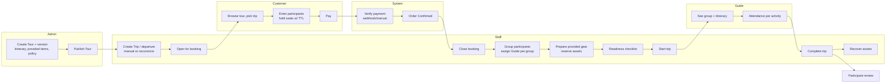

# RenTrek — PRD Understanding Report

> **Phase 1 + Phase 2 deliverable** of the Business Requirements Discovery (Admin · Staff · Tour Guide).
> Date: 13/11/2026 · Status: **for owner review** — nothing here is a new confirmed requirement.
> Labels used below follow the PRD: **[C]** confirmed · **[E]** in ERD · **[D]** PRD proposal (not yet decided) · **[Q]** open decision.

---

## 0. Sources read

| Document | Version / date | Role in this analysis |
|---|---|---|
| `RenTrekk Design System/uploads/PRD_RenTrekk.md` (identical copy in FE and BE) | v0.1, 13/10/2026, *draft* | **Primary source** — read in full (17 sections, 1018 lines) |
| `RenTrekk Design System/uploads/Screen_Spec.md` | updated 30/10/2026 ("synced with real DB + SePay") | Secondary — screen-level spec; **adds decisions not in the PRD** |
| `docs/PRD-CHECK-2026-10-22.md` | 22/10/2026 | Earlier PRD ↔ SQL ↔ Penpot gap check |
| `ADMIN-WORK-PLAN.md` | undated | Team split (5 members) and module ownership |
| `BE/docs/05-MANUAL-REFUND-WORKFLOW.md` | latest BE doc | Current refund implementation |
| `BE/docs/06-RENTAL-PAYMENT-FLOW.md` | BE commit `b20ce5f` | Current rental + SePay payment implementation |
| FE `src/routes/router.jsx`, BE controllers/services | current `develop` | Only to detect conflicts — **not** treated as the business model |

The PRD was generated from the ERD (`Conceptual.drawio`, 51 tables) plus a few confirmed conversation decisions. It states clearly (§17.3) that it has **no customer research, no operations interviews and no legal commitments**. Most status names, permission rules and policies are **[D] proposals**. That is why this interview is needed.

---

## 1. What RenTrek is

RenTrek is a **single-company** web platform (responsive, one app) for:

1. **Discovering and booking trekking tours** — a customer books a scheduled departure (Trip) for themselves and/or other people (participants).
2. **Renting outdoor equipment** — single items (variants) or combos (bundles), priced by number of rental days.
3. **Operating the trips** — grouping participants, assigning guides, preparing company-provided equipment, attendance per activity.
4. **Equipment logistics** — one shared physical inventory (each asset has a unique code) used by rentals, trip-provided gear and promotion gifts.
5. **Money** — collection, refunds, late/damage/loss fees, (deposits — currently deferred).
6. **After-sales** — reviews per participant, preparation content (posts), notifications.

It is **not** a marketplace: no third-party owners, no revenue split, no escrow (PRD §2.5).

## 2. Business objectives (PRD §2.3)

| Code | Objective | Success signal |
|---|---|---|
| G-01 | Customers find, choose and book a suitable trip themselves | Booking completed with clear total, participants and status |
| G-02 | Customers rent single items or combos by duration | Consistent price; resources available for the period |
| G-03 | Operations can manage trips and groups | Every participant, guide, provided item and attendance is traceable |
| G-04 | No double allocation of equipment, no overselling capacity | Concurrent requests never create two conflicting commitments |
| G-05 | Preserve commercial history | Catalog edits never change locked prices, combo contents or old itineraries |
| G-06 | Transparent payment, deposit, fees and refunds | Every amount traceable to order, original transaction, fee or policy |

## 3. Problems the system solves (PRD §2.2 — hypotheses, not research)

- Booking is disconnected from operations (one order, many people, different groups; booker ≠ participant).
- Inventory is split by purpose → double booking between rentals, trip gear and promotion gifts.
- Editing tours / prices / refund policies silently changes the meaning of old orders.
- Unclear what must be collected vs refunded (service fee, deposit, fees, discounts, refunds have different lifecycles).
- Preparation information is scattered (itinerary, bring-your-own items, provided items, guides).

## 4. Users and roles

| Role | Main need (PRD §3.1) | Proposed data limit |
|---|---|---|
| Guest | Browse public tours, trips, equipment, posts | Public data only |
| Customer | Book tours / rent gear, track orders, request cancellation, review | Own orders + participants legitimately linked |
| **Staff** | Coordinate trips, process rental orders, issue/receive gear, create fees | **Assigned scope** (trips they manage, rentals they handle) |
| **Guide** | See assigned group, participant list, take attendance | **Assigned trip/group only; no payment data by default** |
| **Admin** | Catalog, users, policies, operational control | Whole system, every sensitive action audited |

- **[E]** One role per account (`role_id`). Whether one person can be both Staff and Guide is **Q-01**.
- **[D]** Draft permission matrix (PRD §3.2) — key points:
  - Only **Customer** creates orders (Staff creating orders on behalf of customers = **Q-02**).
  - **Admin only:** product/tour/policy management, voiding fees, **approving refunds**, locking accounts, changing roles/config.
  - **Staff (assigned):** create/manage trips & groups, view orders/transactions, request cancellation, edit attendance, issue/receive assets, create rental fees, write posts.
  - **Guide (assigned):** view participants + emergency contacts, record attendance.

## 5. How the business operates (as described by the PRD)

Rental flow (parallel business line): customer picks period + variants/combos → availability check over time → order with held assets → pay → Staff hands over by scanning asset codes → customer returns → Staff records condition per asset → fees (late/damage/loss) → settlement → close order.

Cancellation & refund (PRD §5.4): request → preview refund from the **order's locked policy version** → *"authorized person approves by cancellation type"* → release seats / un-issued assets → refund transaction linked to the original collection → retry-safe.

## 6. Core entities and relationships (PRD §4)

- **Tour** (versioned, `tour_family_id` + `version`) → many **TourActivity**, PreparationItem (bring yourself), **TourProvidedItem** (company-provided, per participant/group/trip).
- **Trip** = one departure of one Tour version: start/end, price per person, capacity, min participants, coordinator (`managed_by_user_id`), refund policy.
- **TripGroup** belongs to one Trip, led by **one Guide**.
- **Order** (exactly one subtype) → **TripBookingOrder** *or* **RentalOrder**.
- TripBookingOrder → many **BookingParticipant** (full name mandatory; account optional; max one group of the same trip).
- **ActivityAttendance** = participant × activity (unique pair).
- RentalOrder → **RentalOrderItem** (variant XOR bundle) → bundle snapshot.
- **EquipmentAsset** (unique code) → **AssetAssignment** with exactly one source: rental line / trip provided item / applied promotion.
- **RentalCharge** (late/damage/loss/other) belongs to a RentalOrder only.
- **Transaction/Payment**: Collection or Refund; refund points to its original collection.
- **RefundPolicy** (versioned) + rules (`min_hours_before` → `%`).
- **Review**: one per participant, after completed trip + paid order.

## 7. Functional requirements by module (PRD §6)

| Module | FR | Priority | Main owner role (draft) |
|---|---|---|---|
| Accounts, sessions, roles | FR-A01–A07 | P0 (external login P2) | Admin (user/role mgmt) |
| Tour catalog & versioning | FR-T01–T06 | P0 | Admin |
| Trips, recurrence, groups, guides | FR-D01–D08 | P0 (recurrence P1) | Staff (assigned) / Admin |
| Tour booking & participants | FR-B01–B07 | P0 | Customer; Staff/Admin view |
| Products, variants, assets, combos | FR-P01–P07 | P0 | Admin |
| Rental orders & handover/return | FR-R01–R09 | P0 (extension P1) | Staff (assigned) |
| Trip-provided gear & shared inventory | FR-I01–I07 | P0 | Staff |
| Promotions | FR-M01–M07 | P1 | Admin |
| Payments, cancellation, refunds | FR-F01–F09 | P0 | System + Admin |
| Deposit & rental fees | FR-C01–C06 | P0 | Staff creates, Admin voids |
| Attendance & reviews | FR-V01–V06 | P0 / P1 | Guide + Staff; Admin moderates |
| Content (posts, tags, skills) | FR-N01–N05 | P1 | Staff / Admin |
| Notifications, audit, config, dashboard, export | FR-O01–O06 | P0–P1 | Admin |

## 8. Booking and payment requirements (key points)

- Booking: one trip per booking, many participants, **seat hold with expiry** (`hold_expires_at`), price locked at confirmation (`unit_price`), server-side price & promotion calculation, refund policy shown before confirm.
- Capacity: `remaining = total_slots − committed − held`; atomic; no oversell under concurrency.
- Payment: confirmation **only** from a verified provider notification or an authorized manual record; idempotent callbacks; late callbacks after hold expiry → *NeedsReconciliation*, never auto-confirm a sold-out trip.
- Order status and payment status are **separate** (Order: Draft → PendingPayment → Confirmed → InFulfillment → Completed / Expired / Cancelled; Payment: Unpaid … Refunded / NeedsReconciliation) — **[D]**.
- Refund amount = locked policy version × rule matched by hours before service start; cannot exceed collected; partial refund per participant **out of scope** in v1.
- Currency VND, no decimals.

## 9. Tour management requirements (key points)

- Tour must have category, main location, name, description, duration, base price before publishing.
- Itinerary = activities by day number, start time, duration, order.
- Two separate lists: bring-yourself items vs provided items (provided items reference a variant and a quantity basis).
- **[C]** Activities belong to the Tour version; trips never copy activities.
- **[C]** Once a version has trips, its itinerary must be stable → edits create a new version.
- Lock moment is **Q-05** (proposal: lock when the first booking is confirmed).

## 10. Key business rules (condensed from PRD §8)

BR-01 one subtype per order · BR-02 server computes all money · BR-03 no retroactive changes · BR-07 atomic capacity · BR-09 participant/group must be in the booking's trip · BR-10 group size ≤ `max_participants` · BR-11 attendance only for activities of the trip's tour version · BR-12 one review per participant · BR-13/14 variant XOR bundle · BR-15 no price tier → cannot sell at 0 · BR-18/19 one source per asset assignment, no overlapping allocations · BR-20 unreturned asset stays blocked · BR-22 damaged/lost asset never re-allocated · BR-29–34 refunds linked to a succeeded collection, never exceed collected, idempotent, no deletion of financial records.

## 11. Non-functional requirements (condensed, all targets are [D])

Object-level authorization on every endpoint (NFR-01) · masked PII in lists, emergency contacts only for trip use (NFR-03) · concurrency integrity (NFR-04) · idempotency (NFR-05) · p95 ≤ 2 s lists, ≤ 1 s detail (NFR-06) · UTC storage, display Asia/Ho_Chi_Minh (NFR-11) · ≥ 360 px screens (NFR-12) · no hard delete of financial data (NFR-13) · test/sandbox separation (NFR-15).

## 12. Scope and limitations

**Out of scope v1 (PRD §2.5, [D]):** marketplace / partner payouts; selling equipment, procurement, accounting, e-invoices; multiple warehouses, delivery routing, live GPS; flights, hotels, **insurance, medical records**; loyalty points, wallet, **real-time chat**, product reviews; one checkout mixing tour + rental; **per-trip custom activities, multiple guides per group, offline attendance sync**; per-participant refunds.

Release plan (PRD §15): R0 business sign-off → R1 platform & catalog → R2 tour booking → R3 rental & inventory → R4 promotions/recurrence/content/reviews/notifications → R5 pilot.

---

## 13. Conflicts found: PRD vs later docs vs current implementation

| # | Topic | PRD v0.1 | Screen Spec (30/10) | BE docs / current code | Why it matters |
|---|---|---|---|---|---|
| X-1 | **Refund execution** | Refund = transaction linked to original collection; Admin approves (§3.2, §5.4) | Admin approves → **automatic SePay refund API**, retry ×3, "mark manual" (O28) | `05-MANUAL-REFUND-WORKFLOW`: **customer enters bank account**, Admin exports Excel with OTP, **accountant transfers manually**, Admin marks complete. FE is deleting the old SePay refund screens (uncommitted) | Three different refund models; PRD-CHECK even said "bank account not needed". Must pick one |
| X-2 | **Cancellation approval** | "Authorized person approves by cancellation type" (§5.4); no cancel-request model (§13.1 #8) | C12 modal | Customer cancel is **immediate**; only the refund is queued (`RefundCase Requested`) | Decides whether Staff/Admin approve cancellations or only refunds |
| X-3 | **Deposit for rentals** | Deposit is a core P0 concept (FR-C01, C05) | **Deposit deferred**, `deposit_amount = 0` | Implemented as 0 | Affects settlement, fees, staff handover |
| X-4 | **Payment method** | Provider not chosen (Q-12); manual recording "if enabled" (FR-F04) | VietQR bank transfer via SePay only; manual record button in O15 | SePay webhook implemented | Who may verify payments manually? |
| X-5 | **Guide role name** | `Guide` | `Guide` | FE has both `Guide` and `TourGuide`; BE uses `Guide` | Technical inconsistency; confirm one role |
| X-6 | **Offline attendance** | Out of scope (§2.5) | G04 queue-and-resend on network loss | Work plan says "offline sync" | Scope creep risk |
| X-7 | **Booking split / group preference** | Not in PRD | `grouping_preference`, `is_split` + approval (O12) | Implemented | Who approves splitting a booking across groups? |
| X-8 | **Participant invitation** | Q-16 open | C19 invitation claim screen | Implemented (invite code/link) | Partially answers Q-16 — needs owner confirmation |
| X-9 | **Staff scope** | "Assigned scope; wider coordination must be configured" | Staff sees trips where `managed_by_user_id` = self, rentals handled by self **or unassigned** | Implemented in BE | Confirm: is Staff really restricted to own trips? |
| X-10 | **Product name** | "RenTrekk" | "RenTrekk" | repo "renTrek", Penpot "TrekRent" | Cosmetic, but should be fixed once |

---

## 14. Missing business decisions (Phase 2)

Each item is either a PRD open question (Q-xx) or a gap found during reading (**N-xx**, new).

### A. Role definition

| ID | Missing decision |
|---|---|
| Q-01 | Can one account hold several roles (e.g., Staff who also guides)? |
| N-01 | Is "Staff" one job or several (trip coordinator / warehouse / order desk / finance)? Should they see each other's work? |
| N-02 | Who creates Trips — Admin, Staff, or both? Who assigns the coordinator? |
| Q-02 | Can Staff/Admin create bookings on behalf of customers (phone/walk-in)? |
| N-03 | Which Staff actions need Admin approval (cancel trip, change capacity/price, void fee, manual payment, booking split)? |
| N-04 | Does the Guide have any responsibility for equipment handover/collection on trips? |
| N-05 | Does Admin also do daily operations, or only governance + approvals? |

### B. Data requirements

| ID | Missing decision |
|---|---|
| N-06 | What a Guide may see: phone, email, DOB, emergency contact, special requests, payment status? |
| N-07 | Are "special requirements" (diet, health notes) collected at all? PRD puts medical records out of scope |
| N-08 | What data does a post-trip report contain (if any)? There is no table for it |
| N-09 | Is there an incident record? No entity exists for incidents during a trip |
| N-10 | Is a guide profile needed (skills, certificates, availability)? Not in ERD |

### C. Workflow requirements

| ID | Missing decision |
|---|---|
| Q-04 | Seat-hold TTL; full payment vs deposit for tours |
| Q-05 | Manual trips vs recurrence only; when to lock the tour version |
| Q-06 | Can a guide lead several groups or overlapping trips? |
| Q-07 | Cancel whole order vs per participant; cancel after departure; **cancel by organizer** (weather, below minimum) |
| N-11 | What happens when a trip does not reach `min_participants` — auto-cancel, Staff decides, Admin decides? Deadline? |
| N-12 | Trip start/completion: who presses the button — Staff, Guide or both? Is Guide confirmation required? |
| N-13 | Incident / emergency escalation path: Guide → Staff → Admin? Any SLA? |
| N-14 | Schedule change during a trip (weather): who decides, how customers are notified, how history is kept? |
| X-1/X-2 | Refund execution model and cancellation approval (see §13) |

### D. Business rules

| ID | Missing decision |
|---|---|
| Q-07/Q-12 | Refund base, processing fee, organizer-cancel compensation |
| Q-10 | Who may review (no-show? no account?) |
| Q-11 | Provided gear quantity basis, cleaning buffer, substitutions |
| Q-17 | Loss/damage of trip-provided gear — who pays? |
| N-15 | Booking edits after confirmation: what can change (names, contacts, participant count)? Until when? |
| N-16 | Attendance corrections after trip completion — allowed? by whom? |
| N-17 | No-show handling: refund? counted as attended? |

---

## 15. Interview plan

| Round | Topic | Status |
|---|---|---|
| 1 | Overall business operation (trip creation, payment verification, cancellation/refund model, staff structure) | **In progress** |
| 2 | Admin responsibilities | Pending |
| 3 | Staff responsibilities | Pending |
| 4 | Tour Guide responsibilities | Pending |
| 5 | Permission matrix | Pending |
| 6 | Workflows & state transitions | Pending |

Decisions are recorded in [`DECISION-LOG.md`](DECISION-LOG.md).
